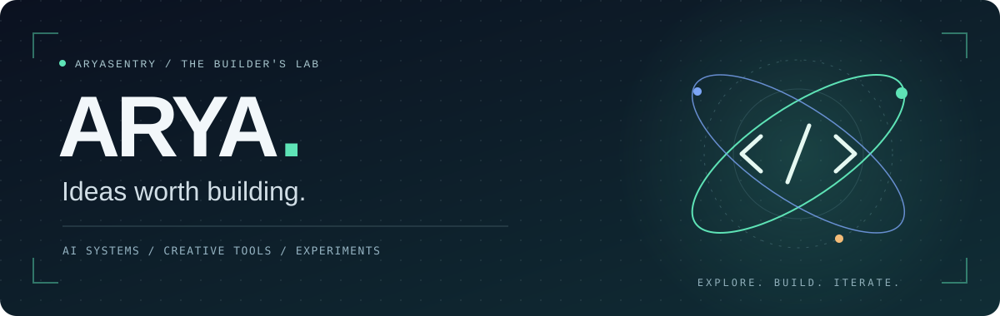
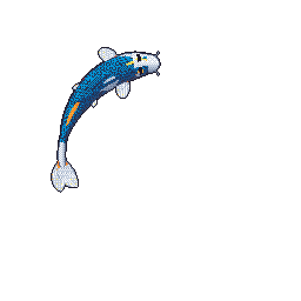
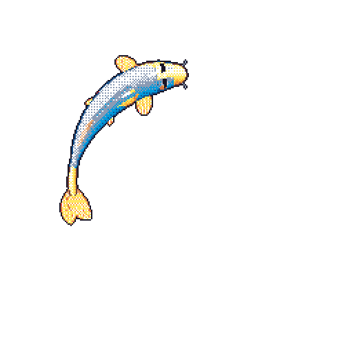
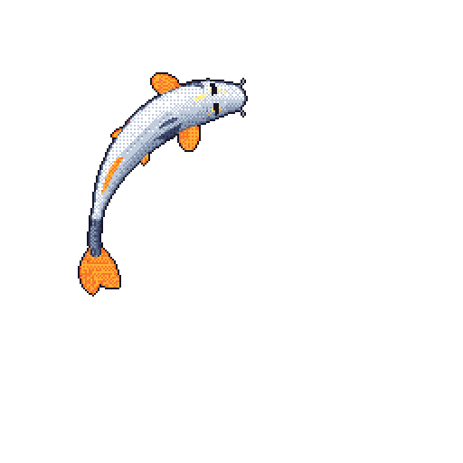

  

  <b>Arya Kalidhindi</b> · Building from India 🇮🇳 
  AI, useful software, and the occasional rabbit hole.

  <a href="https://www.linkedin.com/in/kalidhindi-arya-varmma-484207214/">LinkedIn ↗</a> &nbsp; / &nbsp;
  <a href="mailto:kalidhindi.varmma@gmail.com">Say hello ↗</a> &nbsp; / &nbsp;
  <a href="https://github.com/aryasentry?tab=repositories">Explore the repos ↗</a>

---

  <b>On my radar</b> 
  AI agents &amp; retrieval · Local creative tools · Reproducible experiments

  

  <b>Three fish. One very productive pond.</b> 
  Colour variants driven by my public GitHub activity, refreshed daily. Custom larger bodies · powered by <a href="https://github.com/yalongwastaken/git-koi">git-koi</a>.

### 01 / Things I've been building

<table>
<tr>
<td width="50%" valign="top">
<h3>🎬 <a href="https://github.com/aryasentry/angleforge">AngleForge</a></h3>
<b>Many cameras. One story.</b>

A local multicamera editor with audio synchronization, reversible timeline edits, and FFmpeg export. Optional AI-assisted directing.

React · TypeScript · FastAPI · FFmpeg  
<a href="https://github.com/aryasentry/angleforge">Explore the editor →</a>
</td>
<td width="50%" valign="top">
<h3>🏡 <a href="https://github.com/aryasentry/stillroom">Stillroom</a></h3>
<b>Give a memory somewhere to live.</b>

Turn overlapping photos or video frames into an experimental 3D room, then place notes and media inside it. Reconstruction quality depends on the capture.

Python · WebGL · COLMAP · Gaussian splats  
<a href="https://github.com/aryasentry/stillroom">Step inside →</a>
</td>
</tr>
<tr>
<td width="50%" valign="top">
<h3>🌦️ <a href="https://github.com/aryasentry/weatherpulse">WeatherPulse</a></h3>
<b>Weather, with a longer memory.</b>

Explore historical weather across Indian cities through interactive analytics, with Parquet data and optional Spark/Hadoop processing.

Next.js · FastAPI · pandas · Parquet  
<a href="https://github.com/aryasentry/weatherpulse">Explore the patterns →</a>
</td>
<td width="50%" valign="top">
<h3>⚛️ <a href="https://github.com/aryasentry/q-compass">Q-Compass</a></h3>
<b>Ask the experiment. Keep the evidence.</b>

Compare classical solvers and simulated QAOA for constrained portfolio optimization. A reproducible research prototype, with quantum advantage still unproven.

Python · Qiskit Aer · CVXPY · Next.js  
<a href="https://github.com/aryasentry/q-compass">Inspect the research →</a>
</td>
</tr>
</table>

<b>Also in the workshop</b>

 

- **[IdentityShield](https://github.com/aryasentry/IdentityShield)** — an insurance workflow capstone; the project archive is available in its releases.
- **[Machine Learning Journey](https://github.com/aryasentry/Machine-Learning-Journey)** — earlier notebooks from learning and experimenting with ML.
- **[More repositories](https://github.com/aryasentry?tab=repositories)** — prototypes, coursework, and ideas at different stages.

### 02 / My workbench

| Layer | Tools I build with |
| :--- | :--- |
| **Languages** | Python · TypeScript · JavaScript · Java · SQL |
| **Interfaces** | React · Next.js · Angular |
| **Behind the scenes** | FastAPI · Spring Boot · Node.js · SQLite · MySQL |
| **Data & experiments** | pandas · NumPy · scikit-learn · Qiskit Aer · CVXPY |
| **Creative computing** | FFmpeg · WebGL · COLMAP · Gaussian splatting |

### 03 / Let's make something interesting

I'm interested in collaborating on **AI agents**, **retrieval systems**, and **creative software**. If you're exploring something similar, I'd love to compare notes.

**[Find me on LinkedIn](https://www.linkedin.com/in/kalidhindi-arya-varmma-484207214/)** · **[Send an email](mailto:kalidhindi.varmma@gmail.com)**

---

Built with curiosity. Refined by trying things. The fish handles morale.

